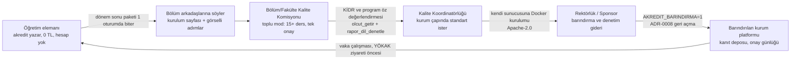

# Akredit: Stratejik Mimari, Otonom MCP ve Büyüme Raporu

- **Tarih:** 2026-11-08
- **Kapsam:** `github.com/tialkan/akredit` deposu (452 commit, ilk commit 2026-09-27), canlı `akredit.org` ve `akredit.org/mcp` (sürüm 0.6.3)
- **Yöntem:** Her olgu depodan ya da canlı uç noktadan okundu. Depodan doğrulanamayan dış iddialar `[DOĞRULANMADI]` ile işaretlendi.
- **Not:** Bu raporun girdisi olan talimat metni 0.6.1'e göre yazılmıştı. 0.6.2 ve 0.6.3'te kapanan maddeler (kopya metni çelişkisi, `hocayaSimdiSor`, değerlendirme kanıt kapısı, niyet çözümü, dilimli tarama, gömülü denetim, otonomi senaryo testi) burada "yapıldı" olarak yer alır; rapor bugünkü duruma göredir.

---

## Uygulama durumu (2026-11-11)

Rapor 0.6.3'e göre yazıldı ve aşağıda değiştirilmedi. Bu tablo, §7.3'teki on sorunun rapordan sonraki durumunu depodan okunan kanıtla verir (canlı sürüm 0.8.0). Gövdede "yapılacak" diye geçen işlerde bu tablo geçerlidir.

| # | Sorun (§7.3) | Durum | Kanıt |
|---|---|---|---|
| 1 | Tarayıcı içi araçlar ana sayfada yok | Yapıldı (kısmen) | Commit `2797dfa`; ana sayfa `/deneyin`'e bağlanır, askıdaki demo `/kurum-demosu` sayfasında (eski `/deneyin#kurum-demosu`). Önerilen ayrı `/araclar` adresi açılmadı; araçlar `/deneyin`'de. |
| 2 | Gerçek Codex/Claude sohbetinde doğrulama | Yapılmadı | `plan/ip/IP-49-acik-mcp.md` 0.7.0 kaydı: "Yapılmadı … Codex denemesi". 0.8.0 için de kayıt yok. |
| 3 | npm paketi eski | Yapılmadı (kısmen) | `npm view @akredit/acik-mcp version` 2026-11-11'de `0.6.0` döndü (raporda 0.5.0); depo 0.8.0. Güncel sürüm yayımlanmadı. |
| 4 | Tarayıcı turlarında kör nokta | Yapıldı | `tarayiciEylemPlani`, `apps/acik-mcp/src/bologna.ts`; commit `2797dfa` (0.7.0). |
| 5 | Toplu özet sunucuda değil | Yapıldı | Araç `bologna_toplu_ozet`, `apps/acik-mcp/src/bologna.ts`; senaryo `test/otonomi-senaryosu.test.ts`; commit `2797dfa`. |
| 6 | `cf-connecting-ip` güveni belgesiz | Belge yapıldı; sunucu ayarı DOĞRULANMADI | `docs/tasarim/yayin-kilavuzu.md` §10.1. Köken sunucunun güvenlik duvarında gerçekten kısıtlandığı depodan görülemez. |
| 7 | Not tablosu sohbete giriyor (KVKK) | Yapıldı (uyarı ve yönlendirme) | `apps/acik-mcp/src/not-tablosu.ts` araç açıklaması `/deneyin#ck` hesaplayıcısına yönlendirir. Araç kaldırılmadı. |
| 8 | `dogrulandi: false` çerçeveler | Yapılmadı | `packages/cerceveler/src/veri.ts`, `veri-resmi.ts`, `program-tablolari/cerceveler.ts` hâlâ `dogrulandi: false`; hücre doğrulama sayfası yok (uzman ister). |
| 9 | CI tam set, askıdaki kod dahil | Yapıldı (kısmen) | Kök `package.json` `verify:canli` var (2026-11-11'de gömülü `baglayicilar` ve `yz` süzgece eklendi). `.github/workflows/ci.yml` hâlâ tam `check`, `typecheck`, `test` çalıştırır. |
| 10 | `sayfaJetonu` yok | Yapılmadı (ertelendi) | Kodda `sayfaJetonu` geçmiyor; günlük 0.6.2 ve 0.6.3: ertelendi, değerlendirme kanıt kapısı şimdilik yeterli görüldü. |

Rapordan sonra, sorun listesinde olmayan ek: peşin onayla tam otonom kip (0.8.0, [ADR 0009](adr/0009-pesin-onay-tam-otonom-kip.md), commit `1dac082`).

---

## Bölüm 1: Yönetici özeti, değer önermesi ve büyüme çarkı

### 1.1 Durum tek paragrafta

Akredit, 6 haftada tek kişiyle yazılmış ~112 bin satırlık bir TypeScript monorepo'sudur. Bunun yalnız ~38 bin satırı (apps/web 32,5k + apps/acik-mcp 5,7k) canlı üründür; kalan ~74 bin satır (servis 23,5k, cerceveler 9,6k, isci 6,9k, yz 4,8k, baglayicilar 4,5k, vt 1,8k, cekirdek 2,6k, belge 2k) ya MCP'nin içine gömülü iş alanı mantığıdır ya da ADR-0008 ile askıya alınan barındırılan kurum platformudur. Canlı ürün sıfır LLM maliyetli, hesapsız, durumsuz bir MCP sunucusu ve tarayıcıda çalışan üç hesaplayıcıdır. Sponsor yoktur; işletme gideri tek bir Coolify sunucusudur `[DOĞRULANMADI: aylık tutar depoda yok]`.

### 1.2 Değer önermesi (olduğu gibi, övgüsüz)

Öğretim elemanının yılda tekrar eden dört işi vardır ve dördü de "boş kutu doldurma" işidir:

| İş | Bugün nasıl yapılıyor | Akredit ile | Kanıt |
|---|---|---|---|
| Bologna ders paketi (11 alan × ders sayısı) | OBS'de elle, her dönem, çoğu kopyala-yapıştır | Asistan OBS'yi okur, sunucu eksiği sayar, asistan taslağı yazar, sunucu biçimi denetler, hoca tek özetle onaylar | `bologna_*` 8 araç, 0.6.3'te tarama tek çağrı |
| AKTS iş yükü tablosu | Toplamı 150'ye getirene kadar deneme | 3 deterministik dağılım, derste olmayan etkinlik eklenmez | `is_yuku_oner` |
| ÇK/PÇ sağlanma düzeyi | Excel'de elle formül | Not sütunlarından hesap; kimlik sütunu reddedilir | `not_tablosu_ayristir`, `ck_pc_hesapla`, `/deneyin` tarayıcı içi |
| Öz değerlendirme / KİDR | Ölçüt metnini hatırlamaya çalışarak, kanıtsız cümlelerle | Resmî metin SHA-256'lı belgeden, dil denetimi kanıtsız iddiayı yakalar | `olcut_getir`, `rapor_dil_denetle` |

Vaat "akreditasyon aldırmak" değildir; `llms.txt` ve `/sinirlar` bunu açıkça yazar. Vaat, **hocanın klavye başında geçirdiği süreyi dakikalara indirmek ve yazılanın uydurma olmadığını kodla garanti etmektir.** Bu ayrım, rakip "ChatGPT'ye yazdır" yaklaşımından tek farktır ve pazarlamanın merkezine bu konmalıdır.

### 1.3 Büyüme çarkı (PLG)



Çarkın bugün çalışan kısmı A→B'dir. B→C'yi döndüren tek şey toplu moddur (Bölüm 2.4). C→D ve sonrası sponsor ister; kod hazırdır, hizmet yoktur.

---

## Bölüm 2: Hoca deneyimi, istemci gerçekleri ve sıfır sürtünmeli akış

### 2.1 Kurulum sürtünmesi: dürüst sayım

Ana sayfadaki dört adım (uygulamayı indir → Chrome eklentisini kur → Akredit'i ekle → `akredit` yaz) yapay zekâ kullanmayan bir hoca için **üç ayrı ücretli/teknik eşik** içerir:

1. **Ücretli plan.** Claude Pro ya da ChatGPT Plus (20 $/ay). Üniversite bütçesinden ödenmesi kamu satın alma süreciyle pratikte imkânsızdır; hoca cebinden öder ya da vazgeçer.
2. **ChatGPT'de Developer Mode / Codex.** Codex masaüstü uygulamasında MCP ekleme "Ayarlar → MCP" altındadır; sitedeki üç görsel bunu gösterir. ChatGPT web'de özel bağlayıcı eklemek ise plana göre değişir `[DOĞRULANMADI: OpenAI'nin güncel plan matrisi depoda yok]`.
3. **Tarayıcı aracı.** OBS'yi okuyup yazmak için Claude in Chrome (Chrome Web Store, `fcoeoabgf…`) ya da Claude masaüstü tarayıcı paneli gerekir. Codex'in OBS'ye yazabilen bir tarayıcı aracı var mı, depoda doğrulanmış bir kayıt yok `[DOĞRULANMADI]`. Bu, Codex kullanıcısı için akışın "kopyala-yapıştır yedeğine" düşmesi demektir (`engel_coz` → `tarayici_araci_yok`).

Sonuç: Hedef kitlenin büyük çoğunluğu için **MCP yolu ikinci yoldur**. Birinci yol, hiçbir kurulum istemeyen tarayıcı içi araçlar olmalıdır. Bunlar zaten vardır (`apps/web/src/deneyin/`: Bologna, ÇK/PÇ ve ölçüt panelleri `"use client"`, sunucuya istek atmaz) ama ana sayfadan kaldırılmıştır ve `/deneyin` sayfasının başında askıdaki kurum demosunun notu durur. **Tarayıcı içi araçlar ile askıdaki kurum demosu aynı sayfada aynı kaderi paylaşıyor; ayrılmalı.** (Bölüm 7, iş planı 1. madde.)

### 2.2 Claude ile ChatGPT/Codex arasındaki MCP davranış farkı

Depoda doğrulanabilen ve bu haftaki oturumlarda gözlenen farklar:

| Kanal | Claude (Desktop, Code, Chrome) | Codex | Bu haftaki karşılık |
|---|---|---|---|
| `initialize.instructions` (`SUNUCU_TALIMATI`, KURAL 1-6) | İzliyor | Kısmen; "akredit"i `rg` ile aradı, araç çağırmadan "hangi ders?" sordu (gözlem, tek oturum) `[DOĞRULANMADI: sistematik ölçüm yok]` | KURAL 1-6 yalnız çerçeve; kritik kurallar araç yanıtlarına taşındı |
| MCP `prompts` | Eğik çizgi menüsünde görünür | Görünmüyor (gözlem) | Prompt içerikleri `akredit_basla` yanıtında `akislar` olarak da dönüyor |
| Araç açıklaması + `inputSchema` | Tam | Tam | `akredit_basla` artık `kullaniciMesaji` alıyor; niyet sunucuda regex ile çözülüyor |
| Araç yanıtı alanları | Tam | Tam | Her yanıtta `hocayaSimdiSor` (bool) + `simdiYap` + `asistanKurali` |
| Tur bütçesi (ardışık araç çağrısı) | Sınır var `[DOĞRULANMADI: sayı]` | Sınır var `[DOĞRULANMADI: sayı]` | Ders başına çağrı 2→1 (gömülü denetim), 15'erli dilim |

Her iki istemcide de işleyen tek güvenilir kanal **araç listesi ve araç yanıtıdır**. 0.6.2–0.6.3 bu kanala yüklendi; doğru yön budur. Kalan risk, modelin tarayıcı aracını kullandığı 3-5 adımlık boşluklardır; orada sunucu görünmezdir (Bölüm 3.3).

### 2.3 Uçtan uca akış, müdahale sayısıyla

Hedef, `test/otonomi-senaryosu.test.ts`'te kodlanmış durumdadır. Bologna için:

| Adım | Araç | Hoca mesajı |
|---|---|---|
| "akredit ders paketimi doldur" | `akredit_basla` (niyet → odak 1, menü yok) | 1 (başlangıç) |
| OBS'yi aç, giriş | tarayıcı; parola hocada | 1 ("girdim") |
| Ders listesi | `obs_ders_listesi` | 0 |
| Her ders: oku + denetle | `bologna_ayristir` (gömülü `denetim`) | 0 |
| Tek rapor + teyit (yüzde, kaynak) | asistan mesajı | 1 ("1, vize 40 final 60") |
| Taslak + denetim + paket | `bologna_alan_rehberi`, `bologna_taslak_denetle`, `bologna_kopya_metni` | 0 |
| Özet tablosu + kayıt onayı | aynı mesaj | 1 ("1") |
| Kaydet, geri oku, doğrula | `obs_karsilastir` | 0 |

**Toplam: 4 hoca mesajı** (ikisi zorunlu: giriş ve kayıt onayı; ikisi niyete bağlı). Değerlendirme sayfada varsa 3. Bundan aşağısı ilke 3 ve 8'i ihlal eder.

### 2.4 Toplu mod tasarımı (15+ ders, tek onay, onay hakkı boşalmadan)

Bugün: `obs_ders_listesi` 15'erli dilim alır, `sonrakiBaslangic` döner, dilim bitince sormadan devam eder. Kopya metni adımı "birden çok ders taranıyorsa tüm derslerin özetini tek tabloda göster" der. Eksik olan, **birleşik özetin sunucu tarafında üretilmesidir**; bugün bunu model kurar.

Önerilen tek ek araç: `bologna_toplu_ozet`

```ts
girdi: { dersler: Array<{ ders: DersTemeli, alanlar: TaslakAlanlari, oncekiDegerler? }> (1-15) }
cikti: {
  tablo: Array<{ sira, kod, ad, degisecekAlanlar: string[], degerlendirme: {metin, dayanak}, isYuku: {toplam, akts}, kaynakSayisi, yazilamayan: string[] }>,
  paketler: Record<kod, obsKarsilastirGirdisi>,
  hocayaGoster: "… 1) Hepsini yaz ve kaydet 2) Yalnız şu numaraları: … 3) Bir dersin tam metnini aç",
  hocayaSimdiSor: true
}
```

Onay hakkı korunur çünkü: (a) her satırda dayanak etiketi (sayfa/hoca/öneri) görünür, (b) "2) yalnız şu numaraları" seçeneği ders düzeyinde ret sağlar, (c) kayıt döngüsünde her dersten sonra `obs_karsilastir` çalışır ve `dur: true` bütün döngüyü keser (0.6.2'de yazıldı), (d) "Onaya Gönder" hiçbir derste basılmaz. Tek onay "15 dersi gözü kapalı yaz" değil, "15 satırlık bir değişiklik listesini onayla"dır; bu, OBS'nin kendi toplu işlem mantığıyla aynıdır.

---

## Bölüm 3: Sıfır halüsinasyonlu otonom MCP mimarisi

### 3.1 Temel ayrım: sunucu metin üretmez, kapı tutar

Mimari, "modeli ikna et" yerine "modelin çıktısını kapıdan geçir" ilkesine dayanır. Bugün çalışan kapılar:

| Kapı | Nerede | Ne engeller | Durum |
|---|---|---|---|
| Kaynak HMAC imzası | `kaynak_dogrula` → `imza`; `bologna_taslak_denetle` ve `bologna_kopya_metni` imzayı doğrular | Katalogda bulunmamış kaynağın "doğrulandı" diye yazılması | Çalışıyor (test: sahte imza reddi) |
| Değerlendirme kanıt kapısı | `degerlendirmeKaniti`: her yüzde kanıt metninde ayrı sayı olarak geçmeli | Modelin "hoca söyledi" deyip %40/%60 uydurması | 0.6.2'de eklendi; test: kanıtta 60 yoksa paket reddeder |
| Yetkili satırları | `bologna_ayristir` görev satırlarını olduğu gibi taşır; `bologna_alan_rehberi` "değiştirmeyin" der | Kişi adı üretilmesi | Çalışıyor |
| Kişisel veri kapısı | `kisisel-veri.ts`: kimlik sütunu, 9-11 haneli numara, e-posta/telefon; künye alanlarında istisna | Öğrenci kimliğinin sohbete/sunucuya girmesi | Çalışıyor; sunucu istek gövdesini günlüğe yazmaz |
| Giriş bilgisi kapısı | `girisBilgisiVar`: parola/kod/çerez görülürse çağrı reddedilir, kaydedilmez | İlke 8 | Çalışıyor |
| Ders kodu/dönem kapısı | `obs_karsilastir` → `dur: true` | Yanlış derse yazma | Çalışıyor |
| Sayılar | `is_yuku_oner`, `ck_pc_hesapla`, `bolognaHesabi` | Modelin ürettiği sayı | Çalışıyor; `asistanKurali` 3. madde |

### 3.2 Yapılmayan tek kalkan: imzalı sayfa jetonu

Dış görüşün önerdiği `sayfaJetonu` (ayrıştırma çıktısındaki değişmez olguları HMAC ile imzalayıp sonraki araçlara zorunlu girdi yapmak) uygulanmadı. Gerekçe: kanıt kapısı aynı saldırı yüzeyini (yüzde uydurma) daha ucuz kapattı. Jetonun hâlâ kapatacağı iki açık vardır:

1. Model `bologna_taslak_denetle`'ye `akts`/`tul`'u sayfadakinden farklı gönderirse iş yükü hesabı yanlış AKTS'ye göre yapılır. Bugün bunu yakalayan yok.
2. Model `obs_karsilastir`'a `beklenen` dizisini eksik verip doğrulamayı "geçirtebilir".

İkisi de **otonomi değil bütünlük** sorunudur ve ikisi de hocanın özet tablosunda görünür (AKTS satırı, alan sayısı). Öncelik: orta. Uygulama 1 gün: `bologna_ayristir` → `sayfaOzeti: {kod, donem, akts, tul, degerlendirmeVar, kaynakSayisi, imza}`; `taslak_denetle` ve `obs_karsilastir` bu alanı alır, imza tutmuyorsa `isError`.

### 3.3 Modelin "kör noktası": tarayıcı turları

Model OBS'yi okurken ve forma yazarken sunucuya uğramaz. Buna karşı iki şey yapıldı: (a) araç yanıtları bir sonraki tarayıcı adımını emir kipinde söyler (`sonrakiAdim`), (b) `engel_coz` beş engelde `asistanOnceKendisiDener` alanı döner (iframe src'ye git, sekmeleri gez, Kaydet'i ara, oturum düşünce yedeği al). Dış görüşün `tarayiciEylemPlani` dizisi fikri bunun yapılandırılmış hâlidir; `obs_ders_listesi` ve `bologna_ayristir` yanıtına 3-5 adımlık bir dizi olarak eklenmesi 2 saatlik iştir ve her iki istemcide de işler. Öncelik: yüksek, çünkü gözlenen "hangi ders?" sorusu tam bu boşlukta çıkıyor.

### 3.4 Kendi kendine toparlanma (yapıldı / yapılmadı)

| Engel | Asistan önce kendisi | Hoca'ya ne zaman sorar |
|---|---|---|
| `cerceve` | iframe src'ye gider | giriş ekranına düşerse |
| `sayfa_okunamiyor` | sekmeleri gezip birleştirir, yeniden ayrıştırır | iki temel alan hâlâ yoksa |
| `kaydet_basilamiyor` | kaydırır, sekmenin Kaydet'ini arar, uyarı penceresini okur | olmazsa |
| `oturum_dustu` | `bologna_kopya_metni` ile yedek alır | hemen; yedekle birlikte tek mesaj |
| `obs_karsilastir` farkı | bir kez aynı değeri yeniden yazar / Kaydet'e basar | ikinci farkta ya da `dur` |
| `kaynak_dogrula` bulunamadı | **yapılmadı**: ikinci aday araması sunucu tarafında tanımlı değil | — |

Son satır küçük bir ekleme: `kaynak_dogrula` yanıtına `bulunamadi` durumunda `sonrakiAdim: "Hocaya sormayın; kendi web aramanızla 2 alternatif ISBN/DOI bulup bir kez daha çağırın. Yine yoksa alanı EKSİK bırakıp sürün."`

---

## Bölüm 4: Akreditasyon içeriği, Bologna kuralları ve ölçme motoru

### 4.1 Çerçeve verisinin gerçek durumu

| Çerçeve | Sürüm (depo) | Kaynak | `dogrulandi` |
|---|---|---|---|
| YÖKAK Değerlendirme Ölçütleri ve Dereceli Anahtar | 3.3 | yokak.gov.tr `national-doc` PDF, SHA-256'lı | false |
| YÖKAK KİDR yapısı | 3.2.1 | aynı | false |
| MÜDEK Lisans | 3.1 | resmî PDF | false |
| MÜDEK Yüksek Lisans | 2.0 | resmî PDF | false |
| FEDEK Lisans | 4.1 | resmî PDF | false |
| SABAK Genel | R4 | resmî PDF | false |
| EPDAD Öğretmen Eğitimi | 1.1 | resmî PDF | false |
| EPDAD RPD | 241216 | resmî PDF | false |

Sekiz çerçevenin sekizinde `dogrulandi: false`. Bu bir kusur değil, ilke 6'nın dürüst uygulamasıdır: metin belgeden alındı, bir uzman karşılaştırmadı. `veri-yokak.ts`'te olgunluk düzeyi tanımları `DOĞRULANMADI` ile dönen hücreler vardır (`GENEL_DUZEYLER`). `/cerceveler` sayfası sayıları veriden hesaplar, elle yazmaz.

**Uzman doğrulama yol haritası** (sıfır maliyet, tek kişi):
1. Her çerçeve için `kaynaklar/resmi/` altındaki PDF'in sayfa numarasıyla `olcut_getir` çıktısını yan yana koyan bir denetim sayfası (`/cerceveler/<kod>/dogrula`, yalnız geliştirici modunda). Hücre başına "aynı / farklı / okunamadı" işareti; işaret bir JSON dosyasına yazılır ve commit edilir. Böylece `dogrulandi` tek bir boolean yerine hücre oranına döner.
2. Doğrulamayı yapan kişi adı ve tarihi kayda girer (ilke 3'ün çerçeve verisine uygulanması).
3. YÖKAK 3.3'ün `A.4.1`, `B.2.2` ve EPDAD `2.1.1` rubrikleri için PDF tablo ayrıştırması yerine o sayfaların görüntüsünden elle aktarım; tablo ayrıştırıcıya zaman harcamaya değmez.

### 4.2 Bologna kuralları ile TYYÇ uyumu

`bologna.ts` K1-K8 kuralları: 4-10 öğrenme çıktısı, ölçülebilir fiil (`-ebilme/-abilme`, `-ebilir` kabul; "sahip olur, farkında olur" ret), 14 hafta + sınav haftaları, 25-30 saat/AKTS (kurum böleni verilirse tam eşitlik), değerlendirme toplamı 100, iş yükü satırı yalnız derste var olan değerlendirme kaleminden. Her bulgu `kuralTuru: "Akredit önerisi"` ve `dayanak: "… resmî dayanağı DOĞRULANMADI"` taşır. Bu etiketleme doğrudur ve korunmalıdır: TYYÇ ve AKTS Kullanıcı Kılavuzu'nun bu sayıları "kural" olarak verip vermediği depoda belgelenmemiştir `[DOĞRULANMADI]`. Tek eylem: `kaynaklar/resmi/` altına AKTS Kullanıcı Kılavuzu'nun (2015, AB) Türkçe çevirisini SHA-256 ile koyup K8'in dayanağını "25-30 saat" cümlesine sayfa numarasıyla bağlamak.

### 4.3 Türkçe kaynak sorunu

`kaynak_dogrula` yalnız Crossref, Open Library ve Google Books'u sorgular. Türkçe ders kitaplarının (Nobel, Seçkin, Pegem, üniversite yayınları) bu kataloglarda bulunma oranı düşüktür `[DOĞRULANMADI: ölçülmedi]`. Bugünkü çözüm `hoca_beyani`: hoca "bunu kullanıyorum" derse künye imzasız ama yazılabilir sayılır. Bu, ilke 2 ile uyumludur (uydurma değil, beyan).

Öneri: ulusal katalog eklemeden önce **ölçüm**. `kaynak_dogrula` zaten imza üretiyor; `bulunamadi` dönen çağrıların sayısı sunucu günlüğünde içerik olmadan sayılabilir (yalnız sayaç, künye değil). İki haftalık sayım %50'nin üstündeyse TOKAT (ULAKBİM) ya da Milli Kütüphane Z39.50/SRU arayüzü için ayrı bir sağlayıcı yazılır `[DOĞRULANMADI: bu arayüzlerin açık ve kota politikası]`. Altındaysa `hoca_beyani` yeterlidir.

---

## Bölüm 5: Güvenlik, KVKK ve hukuki uyum

### 5.1 Herkese açık `/mcp` uç noktası

`apps/acik-mcp/src/http.ts` ve `kaynak-dogrula.ts`'ten okunan koruma:

- İstemci adresi sırası: `cf-connecting-ip` → `x-real-ip` → `x-forwarded-for`; yorum "cf-connecting-ip'ye ancak köken yalnız Cloudflare arkasındaysa güvenilir" diyor. Coolify kurulumunda kökenin doğrudan erişime kapalı olup olmadığı depoda belgelenmemiş `[DOĞRULANMADI]`. Kapalı değilse adres sahteciliğiyle hız sınırı aşılır. **Eylem:** `infra/` altına bir satır: köken yalnız Cloudflare IP aralıklarından kabul eder, ya da `cf-connecting-ip` devre dışı.
- `AdresKovasi`: adres başına 60 istek kapasite, saniyede 1 dolum; `kaynak_dogrula` için ayrı kova 5 istek / 60 s. Bellek koruması: kova sayısı sınırı ve eski kovaların temizlenmesi var mı, okunmadı `[DOĞRULANMADI]`; yoksa adres uzayı taramasıyla bellek şişer.
- Dış istek semaforu süreç genelinde; katalog yanıtı sınırda kesilerek okunur.
- Gövde üst sınırı 400 KB (`html`/`metin` şeması); akışlı okuma `http.ts`'te `[DOĞRULANMADI: okunmadı]`.
- Araçlar `readOnlyHint: true`, `destructiveHint: false`; tek `openWorldHint` kaynak doğrulamada.

Bağımsız sızma testi yok (İP-27 askıda). Sponsor gelene kadar yapılabilecek: `pnpm audit` CI'da zorunlu (Dependabot şu an 2 orta önem uyarısı veriyor), `kaynak_dogrula` için günlük toplam kota (adres başına değil), ve `/mcp`'ye `Content-Type` dışında istek kabul etmeme.

### 5.2 KVKK: asıl risk sohbet penceresidir, sunucu değil

Sunucu istek gövdesini günlüğe yazmaz, kimlik sütununu reddeder, kişisel veri taraması yapar. Ancak hoca not tablosunu **asistanın sohbetine** yapıştırdığında veri önce LLM sağlayıcısına (ABD) gider; Akredit sunucusu o zincirin sonundadır. İlke 7'nin "yurt dışına maskelenmeden gitmez" cümlesi MCP yolunda **sağlanamaz**; yalnız kimlik sütunu reddiyle hafifletilir.

Kökten çözüm zaten depoda: `/deneyin` ÇK/PÇ paneli `"use client"`, sunucuya istek atmaz, hesap tarayıcıda yapılır. **Not tablosu işi için önerilen yol MCP değil, tarayıcı içi panel olmalıdır** ve site bunu açıkça söylemelidir: "Öğrenci notlarını yapay zekâya vermeyin; bu hesaplayıcı bilgisayarınızdan çıkmaz." `not_tablosu_ayristir` MCP'de kalabilir ama açıklaması bu uyarıyı taşımalıdır.

### 5.3 Hukuk metinleri

`/kvkk`, `/gizlilik`, `/kosullar` var; veri sorumlusu adıyla (Tarık İsmet ALKAN) yazılı; başvuru kanalı `iletisim@akredit.org`; posta adresi "bu kanaldan istenebilir". Girdideki "henüz tamamlanmadı" iddiası güncel değildir. Eksik kalanlar:

- `iletisim@akredit.org` adresinin gerçekten çalıştığı test edilmedi (insan işi, açık görev).
- Metinler avukat görmedi; sayfalarda "avukat onaylı" yazılmıyor, doğru. Barındırma açıldığında (ADR-0008 geri açma) kurumla imzalanacak veri işleme sözleşmesi İP-28'de askıda.
- Sağ alttaki tanıtım (`tanitim.tsx`) çerez/izleme kullanmıyor; gizlilik sayfası bunu söylüyor.

---

## Bölüm 6: Monorepo kod kalitesi, test stratejisi ve otonomi ölçümü

### 6.1 Askıdaki kodun yalıtılması

Canlı derleme bugün bütün iş alanı paketlerini içeriyor; `pnpm verify` askıdaki `packages/vt` (PGlite), `apps/isci`, `packages/servis` (488 test) testlerini de çalıştırıyor. Bunun maliyeti CI süresi ve yerelde `baglayicilar`'ın Playwright testi gibi kırılgan noktalar (bu hafta yerelde tarayıcı yok diye kırmızı). Öneri:

- `pnpm verify:canli` = `apps/web`, `apps/acik-mcp` ve onların gömdüğü paketler (cekirdek, cerceveler, olcme, belge, baglayicilar/bologna-ayristir).
- `pnpm verify` tam set, yalnız `main`'e birleştirmede.
- `scripts/derle.ts` zaten yalnız gerekli paketleri `dist/`'e alıyor (`GOMULU` haritası); bu harita `verify:canli`'nin de kaynağı olabilir.

Kod silinmez (ADR-0008 madde 2); yalnız CI yolu ayrılır.

### 6.2 Web katmanı

CSP nonce (`guvenlik/basliklar.ts`, `proxy.ts`) ve `s-maxage` (`layout.tsx`) aynı yanıtta varsa CDN'in önbelleklediği sayfadaki nonce ikinci ziyaretçide farklı olur ve satır içi betikler kırılır. Depoda bu çakışmanın gerçekten yaşandığına dair kayıt yok `[DOĞRULANMADI]`; `basliklar.test.ts` ne denediğini okumadım. Eylem: tek bir e2e testi, aynı sayfayı iki kez isteyip `nonce`'ın yanıt başlığıyla HTML'deki değerin eşleştiğini doğrular. Çakışma varsa seçim: nonce yerine hash tabanlı CSP (statik site için yeterli) ve `s-maxage` korunur.

`@akredit/acik-mcp` npm paketi 0.5.0'da kaldı; canlı 0.6.3. Paket yalnız yerel/stdio kurulum yapanları etkiler. `derle.ts` iş alanı paketlerini göreli yola çevirerek gömüyor; yayın adımı insan ister (`npm login`). CI'da `pnpm --filter @akredit/acik-mcp build && node dist/… --version` dumanı var mı `[DOĞRULANMADI]`; yoksa eklenmeli ki yayın anında kırık paket çıkmasın.

### 6.3 Otonomi ölçümü (yapıldı)

`test/otonomi-senaryosu.test.ts` kural tabanlı sahte asistanla şu sözleşmeyi koşuyor: "akredit ders paketimi doldur" → menü yok → iki ders tek çağrıyla ayrıştırılıp denetlenir (`bologna_denetle` çağrılmaz) → tek rapor durağı → kayıt onayı durağı → geri okuma `dur: false`; **durak sayısı ≤ 2**. İkinci senaryo: kanıtsız yüzde paketten düşer. Genişletme sırası:

1. Değerlendirmesi sayfada dolu ders → teyit durağı olmadan ≤ 1 durak.
2. 17 ders → iki dilim, dilim arası durak 0.
3. `obs_karsilastir` farkı → bir kez toparlama, ikinci farkta durak.
4. Codex benzeri "talimatı okumayan" sahte asistan: yalnız araç açıklaması ve yanıt alanlarını okuyan ikinci bir sahte asistanla aynı senaryolar. Bu, Bölüm 2.2'deki "iki istemcide de çalışır" iddiasını teste çevirir.

---

## Bölüm 7: Sürdürülebilirlik, benimsenme ve yol haritası

### 7.1 Sıfır maliyetle trafik

1. **Tarayıcı içi araçlar ana sayfaya geri döner**, "kurulum istemez, veriniz bilgisayarınızdan çıkmaz" cümlesiyle; askıdaki kurum demosu ayrı sayfaya (`/kurum-demosu`) alınır. Search Console zaten 27 sayfayı okudu; dizine girmeyen 7 sayfa `[DOĞRULANMADI: nedenler işleniyor]`.
2. **Tek tıkla şablonlar:** Claude Project ve Custom GPT, içinde `SUNUCU_TALIMATI`'nın hoca diliyle yazılmış hâli ve MCP adresi. Custom GPT'nin özel MCP bağlayıcısını çağırabilmesi kullanıcı planına bağlı `[DOĞRULANMADI]`; çağıramıyorsa GPT yalnız "metni yapıştır, ben denetlerim" yoluyla `/deneyin` panellerine yönlendirir.
3. **Bölüm Kalite Komisyonu paketi:** tek bir sayfa: "dönem başında 15 dersi 1 saatte nasıl kapatırsınız" + toplu mod + KİDR iskeleti. Komisyon başkanları hedef kitlenin çarpanıdır.
4. **npm ve MCP dizinleri:** `@akredit/acik-mcp` 0.6.3 yayınlanır; MCP sunucu dizinlerine (`modelcontextprotocol/servers` listesi, Smithery vb.) kayıt `[DOĞRULANMADI: başvuru koşulları]`.

### 7.2 Gelir / sürdürülebilirlik modeli

| Yol | Gider | Gelir | Koşul |
|---|---|---|---|
| Açık MCP + tarayıcı içi araçlar | tek VPS | 0 | bugün |
| Kurum kendi sunucusunda (Docker, `infra/`) | 0 (kurumun) | 0; isteğe bağlı kurulum danışmanlığı | kod hazır; kurulum belgesi İP-34 askıda |
| Sponsorlu barındırma | sunucu + yedek + e-posta + LLM + bağımsız denetim | sponsor | ADR-0008 geri açma |
| Kurumsal lisans/destek | aynı + insan | yıllık sözleşme | KVKK sözleşmesi (İP-28), sızma testi (İP-27) |

Kamu üniversitesinin ihale eşiği altında doğrudan temin yapabilmesi mümkündür `[DOĞRULANMADI: güncel eşik tutarı]`; vakıf üniversiteleri daha hızlıdır. İlk sponsor adayı, akreditasyon ziyareti yaklaşan bir vakıf üniversitesinin kalite koordinatörlüğüdür.

### 7.3 En kritik 10 sorun (öncelik sırasıyla)

| # | Sorun | Etki | Çözüm | Süre |
|---|---|---|---|---|
| 1 | Tarayıcı içi araçlar ana sayfadan kaldırıldı; kurulumsuz yol görünmüyor | Hedef kitlenin çoğu MCP kuramaz | Panelleri ana sayfaya ve `/araclar`'a al, demo notunu ayır | 0,5 gün |
| 2 | 0.6.3 gerçek Codex/Claude sohbetinde doğrulanmadı | Tüm otonomi işi varsayım | Yeni sohbette uçtan uca tur; ekran görüntüsü | insan, 1 saat |
| 3 | npm 0.5.0 | Yerel kurulum kırık/eski | `npm login`, yayın | insan, 10 dk |
| 4 | Tarayıcı turlarında kör nokta | "hangi ders?" tekrar edebilir | `tarayiciEylemPlani` dizisi | 2 saat |
| 5 | Toplu özet sunucuda değil | 15 derste model tabloyu bozabilir | `bologna_toplu_ozet` | 1 gün |
| 6 | `cf-connecting-ip` güveni belgesiz | Hız sınırı aşılabilir | infra notu + köken kısıtı | 1 saat |
| 7 | KVKK: not tablosu sohbete giriyor | Yurt dışı aktarım | Not işini panele yönlendir, araç açıklamasına uyarı | 2 saat |
| 8 | `dogrulandi: false` × 8 | Resmî metin güvenilirliği | Hücre bazlı doğrulama sayfası | 2 gün + uzman |
| 9 | CI tam set, askıdaki kod dahil | Yavaş, kırılgan | `verify:canli` | 2 saat |
| 10 | `sayfaJetonu` yok | AKTS/beklenen bütünlüğü | Bölüm 3.2 | 1 gün |

### 7.4 İlk 2 hafta

**Hafta 1**
- Gün 1: #3 npm yayını, #2 Codex ve Claude'da uçtan uca deneme, bulguları İP-49 günlüğüne.
- Gün 2: #1 tarayıcı içi araçları ana sayfaya; demo notunu `/kurum-demosu`'na.
- Gün 3: #4 `tarayiciEylemPlani` + `kaynak_dogrula` ikinci deneme adımı; otonomi senaryosu 1-2.
- Gün 4-5: #5 `bologna_toplu_ozet` + senaryo 3; 0.7.0.

**Hafta 2**
- Gün 6: #6, #7 (infra notu, KVKK yönlendirme).
- Gün 7: #9 `verify:canli`.
- Gün 8-9: #8 doğrulama sayfası; YÖKAK 3.3 ilk 20 hücre elle.
- Gün 10: Bölüm Kalite Komisyonu sayfası; Search Console dizin raporu.

### 7.5 6 aylık OKR

| Amaç | Anahtar sonuç | Ölçüm kaynağı |
|---|---|---|
| Hoca müdahalesi en aza | Bologna turunda ≤ 3 mesaj (değerlendirme sayfada varsa) | otonomi senaryo testleri; gerçek sohbet örnekleri |
| Kurulumsuz kullanım | Tarayıcı içi araç sayfalarının aylık tekil ziyareti ≥ MCP sayfasının 3 katı | Search Console / sunucu günlüğü (içeriksiz) `[DOĞRULANMADI: analitik aracı yok]` |
| Güvenilir resmî metin | YÖKAK 3.3 ve MÜDEK 3.1'de hücre doğrulama oranı ≥ %90 | doğrulama JSON'u |
| Kurumsal temas | 3 bölüm kalite komisyonu ile toplu mod denemesi; 1 sponsor görüşmesi | İP-30 günlüğü |
| Sürdürülebilir kod | `verify:canli` < 3 dk; Dependabot açık uyarı 0 | CI |

---

## Bölüm 8: Özet karar matrisi

| Bileşen | Karar | Gerekçe |
|---|---|---|
| Sunucu model çağırmaz, metin üretmez | **Koru** | Sıfır LLM maliyeti ve uydurma kapılarının temeli |
| Araç yanıtı kanalı (`sonrakiAdim`, `hocayaSimdiSor`, `asistanKurali`) | **Koru, genişlet** (`tarayiciEylemPlani`) | İki istemcide de çalışan tek güvenilir kanal |
| `SUNUCU_TALIMATI` KURAL 1-6 | **Koru, kısalt** | Codex'te etkisi düşük; kritik kural yanıtlarda |
| MCP `prompts` | **Koru, yatırım yapma** | Yalnız Claude'da görünür |
| Değerlendirme kanıt kapısı, kaynak HMAC | **Koru** | İlke 2'nin kod hâli |
| `sayfaJetonu` | **Ekle (orta öncelik)** | Bütünlük; otonomi değil |
| `bologna_toplu_ozet` | **Ekle** | Toplu modun onay hakkını koruyan tek yolu |
| Tarayıcı içi `/deneyin` panelleri | **Değiştir: ana sayfaya ve ayrı adrese** | KVKK ve kurulum sürtünmesi için birinci yol |
| Askıdaki kurum demosu | **Askıya al (görünürlükte), kod koru** | ADR-0008 |
| `packages/vt`, `servis`, `isci`, `yz` | **Askıda, CI'dan ayır** | Canlı ürünün parçası değil |
| `apps/cli` | **Koru** | Çalışır durumda; `node --test` |
| 8 çerçeve `dogrulandi: false` | **Değiştir: hücre bazlı doğrulama** | İlke 6 |
| K1-K8 "Akredit önerisi" etiketi | **Koru** | Resmî dayanak DOĞRULANMADI; dürüst |
| `kaynak_dogrula` üç katalog | **Koru, ölç** | Türkçe oranı ölçülmeden ulusal katalog ekleme |
| `hoca_beyani` | **Koru** | Beyan ≠ uydurma |
| `/kvkk`, `/gizlilik`, `/kosullar` | **Koru** | Veri sorumlusu ve kanal var; avukat onayı iddia edilmiyor |
| Not tablosu MCP'de | **Değiştir: panele yönlendir** | Yurt dışı aktarım |
| `cf-connecting-ip` sırası | **Değiştir: belgele ya da kapat** | Hız sınırı bütünlüğü |
| npm paketi | **Yayınla** | 0.5.0 eski |
| Sağ alt tanıtım | **Koru** | Çerezsiz, kapatılabilir, 7 s |
| Sponsor arayışı metni | **Koru** | "hazır ama askıda" dürüst |
